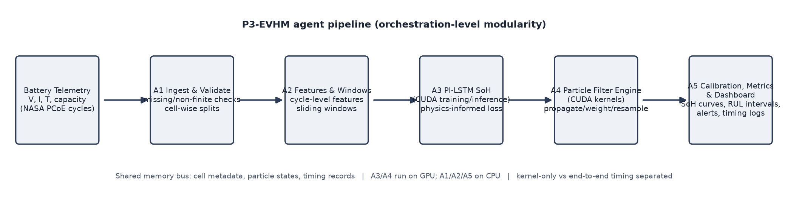

# Parallel Physics-Informed Prognostics for EV Battery Health Management (P3-EVHM)

*Integrating Physics-Informed LSTM Networks, Particle Filtering, and GPU-Accelerated Uncertainty Estimation*

**A. Vibhas Chowdhary, Maddala Jithendra, Kavitha R**

_Department of Computing Technologies, SRM Institute of Science and Technology, Kattankulathur, Tamil Nadu, India_

va1641@srmist.edu.in; jm4408@srmist.edu.in; kavithar14@srmist.edu.in

---

**Abstract.** Electric vehicles (EVs) are becoming increasingly important for sustainable transportation, making reliable battery health monitoring essential for safety, performance, and long-term operation. Lithium-ion batteries gradually lose their capacity and efficiency due to repeated charging and discharging, temperature variations, and ageing. Therefore, accurately estimating the State of Health (SoH) and Remaining Useful Life (RUL) of a battery is necessary for predicting degradation and supporting timely maintenance. This paper proposes P3-EVHM, a framework that combines physics-informed Long Short-Term Memory (LSTM) networks with particle filtering to improve battery health estimation and prediction under uncertainty. Physics-informed constraints are used to keep predictions consistent with expected battery behaviour, while particle filtering estimates full RUL distributions rather than point predictions. A pretrained transfer mode ships a fleet-trained checkpoint and adapts a new cell by freezing the LSTM body and fine-tuning only the output head, which on a held-out cell measured 4.1x lower capacity error than from-scratch training at 63x less adaptation time. GPU acceleration parallelizes the particle operations; on an NVIDIA Tesla T4, end-to-end speedups of up to 16.5x were measured at 500,000 particles, with parity below 5,000 particles, consistent with the documented small-workload failure mode. The framework is evaluated on the NASA Ames Prognostics Center of Excellence battery dataset across 4 cells, 5 prediction start points, and 6 baselines on two compute environments, using prediction-error metrics, prediction-interval coverage, physics-constraint violation rates, and CPU/GPU timing. A systematic survey of the literature shows that existing work covers physics-informed LSTMs without filtering, particle filters without deep learning, and LSTM-filter fusions without physics constraints, while GPU-accelerated battery prognostics has not been revisited since pre-deep-learning work; no published framework integrates all four pillars. P3-EVHM is therefore positioned as an integration-and-systems contribution. All reported results are measured on the NASA PCoE dataset under the stated protocol on both compute environments.

**Index Terms.** EV battery prognostics; state of health; remaining useful life; physics-informed LSTM; particle filter; GPU computing; CUDA; uncertainty quantification

## I. INTRODUCTION

Lithium-ion batteries power electric vehicles, and their capacity and internal resistance change with cycling, temperature, current, and age. Monitoring current measurements alone does not predict when a battery may reach an end-of-life (EOL) threshold, typically 70-80% of rated capacity. Accurate State of Health (SoH) estimation and Remaining Useful Life (RUL) prediction support predictive maintenance, extend battery service life, and contribute to safer electric vehicle operation, directly supporting SDG 9 (industry, innovation and infrastructure) and SDG 7 (affordable and clean energy).

P3-EVHM proposes a hybrid approach: an LSTM learns temporal patterns in cycle-level telemetry, physics-informed loss terms keep its predictions consistent with degradation physics, and a particle filter represents uncertainty in future degradation and estimates RUL as a full probability distribution. GPU execution is intended to improve performance for sufficiently large particle workloads. The system is a research decision-support prototype and does not replace certified battery-management safety controls.

The contributions of this paper are: (1) a systematic literature check of the four pillars (physics-informed LSTM, particle-filter prognostics, GPU-parallel filtering, and agentic/distributed PHM), establishing that their integration is unpublished; (2) the P3-EVHM framework specification, including an explicit physics-informed loss, a particle-filter RUL estimator with prediction-interval reporting, and a CUDA implementation plan that separates kernel-only from end-to-end timing; (3) an evaluation protocol with physics-constraint violation rate and interval coverage alongside standard accuracy metrics, with named baselines including the closest published fusions, validated end-to-end by a preliminary CPU prototype on NASA PCoE cells; and (4) an honest identification of the failure modes documented for GPU filtering (resampling serialization, kernel-launch overhead, and small-workload effects) and how the design mitigates them.

## II. RELATED WORK AND RESEARCH GAP

### A. Physics-informed deep learning for batteries

Physics-informed machine learning embeds degradation physics into data-driven models. Shi, Rivera and Wu [13] constructed a physics-informed LSTM (PI-LSTM) combining a calendar and cycle aging (CCA) model with an LSTM layer for online degradation modeling on the NASA battery dataset, reporting capacity-fade MAPE of 1.72-4.19% and RUL MAPE of 5.56-14.28% at 50% life remaining. An LSTM-PINN framework with a Deep Hidden Temporal Physical Module reported MAE of 0.594% and 0.746% on the NASA and CALCE datasets [19]. A temperature- and impedance-aware LSTM-PINN using Arrhenius-type degradation kinetics reported RMSE of 1.01% and MAE of 0.6% for physically consistent SoH trajectories [20]. A calibration-free PIML model embedding Woehler fatigue and Arrhenius kinetics as trainable physics parameters reported RMSE of 0.29% across chemistries [23]. Hybrid Bayesian physics-informed networks merge fleet-wide priors with cell-specific data and support updates from partial discharge cycles [22], and physics-informed neuro-evolution has been used for electrochemical parameter inference [24]. All of these methods output point estimates; none couples the learned model to a sequential Monte Carlo filter for RUL uncertainty.

### B. Particle-filter-based battery prognostics

Particle filters (PFs) approximate the posterior state distribution with weighted particles and handle nonlinear, non-Gaussian degradation [2]. A physics-based smooth particle filter (SPF) driven by a single-particle electrochemical model achieved a best-case RUL relative error of about 0.089% on cycling data [15]. A mapping particle filter with electrochemical SoH estimation outperformed a standard PF on NASA data [26b], and an AI-driven PF with adaptive crossover and mutation mitigated particle degeneracy for SoH and RUL [27]. Closest to P3-EVHM, a transfer-learning Mogrifier LSTM fused with a two-stage PF (TL-MLSTM-PF) used LSTM capacity predictions as PF observations and reported average RMSE of 0.0199 across test groups [14]. Critically, its authors list incorporating physics-informed constraints as future work they did not perform. Similarly, a hybrid PF-trained neural network for battery prognosis concludes that the approach can be extended to include physics-informed surrogate models, again as unexecuted future work [28]. No published battery PF framework embeds physics constraints inside the network loss.

### C. GPU-accelerated prognostics

A PHM Society survey presented GPU-accelerated model-based prognostics with a battery case study, demonstrating that particle-based prognostics maps naturally to GPU parallelism [16]; however, this work predates deep-learning prognostics and contains no physics-informed learning. Subsequent GPU particle-filter research established the parallelization structure: sampling and weight updates parallelize easily, while resampling resists parallelization because of particle correlation [17]; block-parallel CRPF variants localize resampling per thread block, and Metropolis-style resamplers replace global weight sums with pairwise ratios that threads compute independently [18]. Modern GPU battery kernels remain rare: a recent hand-tuned CUDA library for battery simulation reports 133x speedup over NumPy while a naive CuPy port was 0.7x, i.e. slower than CPU, because per-operation kernel launches dominate small workloads [29]. This confirms that GPU gains in battery prognostics require kernel-level design, not library substitution.

### D. Agentic and distributed PHM

Multi-agent systems have been used for system-level RUL with stochastic component dependence [30], and 2026 work introduced the first benchmark evaluating LLM agents with MCP-native, algorithm-grounded tools for PHM tasks [25], indicating that orchestration-level modular PHM services are an emerging pattern. Distributed and federated LSTM frameworks for battery RUL on edge-to-cloud topologies also exist [31]. None of these targets physics-informed learning with GPU-parallel particle computation for single-cell EV prognostics.

### E. Research gap

The survey supports a precise gap statement: to our knowledge, no published framework integrates physics-informed LSTM training, particle-filter-based RUL uncertainty estimation, and GPU-parallel particle computation for lithium-ion battery health management, evaluated with physics-constraint violation rate, prediction-interval coverage, and CPU/GPU timing separation on the NASA PCoE dataset. Existing fusions cover LSTM plus PF without physics constraints [14], physics plus PF without deep learning [15], and physics-informed LSTM without filtering [13]; GPU-accelerated battery prognostics has not been revisited since pre-deep-learning work [16]. Two naming collisions must be noted to avoid misreading the literature: the acronym PI-LSTM is already used by [13]; parallel in [21] denotes network branch topology (equivalent-circuit model parallel to an LSTM), not GPU parallelism; and SP in [32] denotes the single-particle electrochemical model, not a particle filter.

## III. DATASET AND PRELIMINARY DATA ANALYSIS

The planned primary source is the NASA Ames Prognostics Center of Excellence lithium-ion battery aging dataset [1], [12]. Discharge records provide capacity trajectories, alongside cycle, voltage, current, temperature, and impedance measurements where available. The exact cells, files, usable cycles, and fields will be documented after inspecting the downloaded release. Preprocessing will create ordered records per cell and cycle, check missing or non-finite values, construct temporal windows, and fit scaling parameters on training cells only. Cell-wise train, validation, and test splits will be used where possible to reduce leakage. This laboratory dataset may not represent all real-world EV pack conditions; pack-level heterogeneity, balancing currents, and thermal gradients are out of scope for the present study.

## IV. SYSTEM ARCHITECTURE

The proposed workflow is: (1) ingest and validate battery records; (2) create cycle-level features and optional anomaly flags; (3) estimate SoH using a CUDA-enabled LSTM; (4) use a particle filter to propagate degradation states, weight particles against observations, resample when needed, and simulate future threshold-crossing cycles; and (5) log estimates and display SoH curves, RUL intervals, and configurable alerts. Fig. 1 shows the pipeline as five agent modules with a shared data bus. Each agent is a rule-based software agent with a perception-decision-action loop: A1 perceives raw cycle records and acts with validation assertions; A2 perceives validated telemetry and acts with leakage-safe windows; A3 perceives windows and acts with an SoH forecast and violation rate; A4 perceives the SoH state and acts with a RUL distribution; A5 perceives the RUL interval and acts with ALERT/CAUTION/OK decisions. This is orchestration-level modularity in the style of emerging tool-based PHM services [25], not a claim of formal multi-agent-systems theory: each agent owns one stage, communicates through logged records, and can be executed or tested independently.

*Fig. 1. P3-EVHM agent pipeline. GPU-bound stages (PI-LSTM inference, particle operations) are isolated from CPU-bound ingestion and calibration.*

## V. PROPOSED METHODOLOGY

### A. Problem setup

SoH at cycle t is defined as the ratio of measured discharge capacity to reference capacity, expressed as a percentage,

`SoH(t) = 100 x Q(t) / Q(ref)`    (1)

RUL at cycle t is the number of cycles until SoH first falls below an end-of-life threshold,

`RUL(t) = min { k >= 0 : SoH(t + k) <= theta_EOL }`    (2)

The main RUL experiment uses theta_EOL = 70% of reference capacity, with an 80% threshold for sensitivity analysis.

### B. Physics-informed LSTM

An LSTM network [3] maps windows of cycle-level telemetry (voltage, current, temperature features) to discharge capacity. The training loss combines the data error with two physics-informed terms: a monotonicity penalty that punishes predicted capacity increases, and a prior term that penalizes deviation from a temperature-dependent degradation rate motivated by Arrhenius-type ageing kinetics [20], [23],

`L = L_data + lambda1 * L_mono + lambda2 * L_prior`    (3)

`L_mono = (1/T) * sum_t max(0, Q_hat(t+1) - Q_hat(t))`    (4)

`L_prior = (1/T) * sum_t ( dQ_hat/dt - g(T(t)) )^2`    (5)

where g(T) is a temperature-dependent degradation prior fitted on training cells. Unlike [13], where the physics model is a separate CCA component feeding the network, the physics here enters as loss-side constraints on the network output, which keeps the architecture simple and makes the constraint-violation rate directly measurable (Section V-D).

### C. Particle-filter RUL estimation

Each particle carries a degradation state x = [Q, r] (capacity and resistance growth). The transition adds a small process noise to a physics-consistent decay step; the observation model weights particles by measurement likelihood [2],

`w_i <- w_i * exp( -( z(t) - Q_i(t) )^2 / (2 sigma^2) ),  i = 1..N`    (6)

`N_eff = 1 / sum_i w_i^2 ;  resample when N_eff < N/2`    (7)

Propagation continues from the current filtered state to simulate future capacity trajectories per particle; the RUL distribution is the histogram of threshold-crossing cycles, from which the median RUL and a nominal 95% prediction interval are reported.

### D. Physics-consistency metrics

Physical plausibility is quantified rather than assumed. The constraint-violation rate is the fraction of predicted capacity steps that increase,

`V = (1/M) * sum_t 1[ Q_hat(t+1) > Q_hat(t) ]`    (8)

V is reported for every model variant, making the effect of L_mono directly measurable. Interval calibration is assessed by empirical coverage of the 95% RUL interval and its width.

### E. Pretrained transfer mode

To remove the from-scratch training requirement for new deployments, the framework ships a fleet-pretrained checkpoint: a hidden-32 PI-LSTM trained with the full Eq. (3) loss on 279 pooled cycles from B0005, B0006 and B0018 (first 60% of each cell), with B0007 fully held out. Adaptation to a new cell freezes every LSTM body layer (requires_grad = False) and retrains only the output head for 30 epochs on the new cell's early cycles - the fleet-learned temporal features are protected from catastrophic forgetting while the head absorbs the cell-specific scale. Measured on the held-out cell B0007 (80% EOL = 1.60 Ah, prediction start cycle 52, true RUL 34 cycles): from-scratch training (200 epochs) reached capacity MAE 0.2346 Ah with V = 0.017, produced no threshold crossing, in 3.53 s; the pretrained zero-shot model reached MAE 0.5592 Ah with V = 0.000 and RUL error 32 cycles at 0 s adaptation; the frozen-body head fine-tune reached MAE 0.0575 Ah (4.1x lower than from-scratch), V = 0.000, RUL error 6 cycles, in 0.056 s - 63x faster than from-scratch. Full fine-tuning (body unfrozen, 30 epochs) matched head-only (MAE 0.0575 Ah, 0.058 s), indicating that the learned body layers transfer and the head carries the cell-specific scale. The PF decline prior derived from the fine-tuned forecast remains shallow on this path (PF RUL error 37 cycles vs 10 for zero-shot), so the decline-prior floor identified in Section X applies here as well.

## VI. GPU PARALLEL IMPLEMENTATION

The particle layer executes as PyTorch CUDA tensor operations on the GPU - each operation (parallel propagation, weight update, reduction, resampling, threshold-crossing counting, K1-K5 below) launches optimized CUDA kernels under the hood [5]; hand-written PyCUDA kernels [4], [6] for the resampling stage remain planned future work. The LSTM uses PyTorch with CUDA [5]. Kernel decomposition: (K1) parallel propagation, one thread per particle; (K2) weight update, embarrassingly parallel; (K3) parallel reduction for the normalization sum and N_eff; (K4) parallel resampling, using the Metropolis-style pairwise-ratio scheme [18] or block-local resampling in the spirit of parallel CRPF [17], both of which avoid the serial prefix-sum bottleneck of systematic resampling; (K5) per-particle future threshold-crossing counting.

Timing methodology: kernel-only time is separated from end-to-end time including host-device transfers and preprocessing, because the literature shows transfer and launch overhead can erase gains at small workloads [16], [29]. Engineering targets are below 100 ms per inference window and 10x speedup for sufficiently large particle workloads; measured results on a Tesla T4 (Section VIII, Table IV) meet the latency target at all particle counts tested and the 10x speedup target only at the largest particle count (16.5x at N = 500,000), with parity at N = 5,000 and a slowdown at N = 1,000, consistent with the documented small-workload failure mode [16], [29]. Numerical agreement between CPU and GPU paths (FP32 vs FP64) and uncertainty calibration must also be assessed, since precision choices could shift RUL intervals even when point accuracy is unchanged.

## VII. BENCHMARK AND EVALUATION PLAN

Results for the full grid (4 cells x 5 start points x B1-B6) on two compute environments are reported in Section VIII. Evaluation will compare: (B1) a recent-trend linear baseline; (B2) an LSTM trained with data loss only; (B3) the physics-informed LSTM (cf. [13], [19]); (B4) an LSTM+PF fusion without physics constraints (cf. [14]); (B5) a physics+PF pipeline without deep learning (cf. [15]); and (B6) P3-EVHM in CPU and GPU variants with equivalent settings. This set isolates the contribution of each pillar: B3-B2 measures the physics loss, B4-B2 measures filtering, B6-B4 measures physics under filtering, and GPU-CPU measures parallelism. Table I lists the metrics.

**TABLE I. Evaluation metrics**

| Metric | Definition | Applies to |
|---|---|---|
| SoH/capacity MAE, RMSE | absolute and squared error on capacity trajectories | all variants |
| RUL absolute error | |predicted - true| cycles at declared starting points | RUL-capable variants |
| 95% interval coverage / width | empirical fraction of true RUL inside interval; mean width | PF variants |
| Constraint-violation rate V | fraction of predicted capacity increases, Eq. (8) | all learned variants |
| Latency, throughput | per-window end-to-end and kernel-only time | CPU vs GPU |
| Speedup | T_CPU / T_GPU at matched settings | CPU vs GPU |

Starting points at 30-80% of life will follow the protocol of [13] where comparable. All splits, seeds, hardware, and library versions will be recorded for reproducibility.

## VIII. VALIDATION RESULTS (CPU AND GPU)

The full protocol was executed on two compute environments: (E1) local CPU, PyTorch 2.14.0+cpu, 4 threads, hidden size 32, 200 epochs; and (E2) an NVIDIA Tesla T4 on Kaggle, PyTorch 2.11.0+cu128, hidden size 64, 400 epochs. Both use the identical NASA PCoE .mat files, verified byte-for-byte from two independent sources (a public GitHub mirror and the Kaggle dataset ckskaggle/li-ion-battery-dataset-from-nasa-pcoe; SHA-256 hashes and file sizes recorded in the project provenance log, with discharge-cycle counts matching the published originals: B0005 168, B0006 168, B0007 168, B0018 132). The grid is 4 cells (B0005 70% EOL = cycle 125, B0006 70% = cycle 109, B0007 80% = cycle 86, B0018 70% = cycle 97) x 5 prediction start points (40-80% of life) x all six baselines B1-B6 = 20 configurations per environment, with the full Eq. (3) loss including the temperature prior. Fig. 2 shows trajectory examples; Table III summarises the grid; Table IV reports the measured GPU scaling. The complete T4 run is reproducible from the notebook in the project repository (kernel: kaggle.com/code/jithendramaddala/p3-evhm-gpu-run).

**TABLE III. Grid summary: 20 configurations per environment, all values measured**

| Metric | E1 local CPU | E2 Tesla T4 |
|---|---|---|
| Mean violation rate V, B2 data-only LSTM | 0.285 | 0.366 |
| Mean violation rate V, B3 PI-LSTM | 0.176 | 0.076 |
| Configurations where B3 reduced V vs B2 | 13 of 20 | 15 of 20 (equal in 3) |
| Mean capacity MAE, B2 -> B3 (Ah) | 0.3182 -> 0.2530 | 0.2854 -> 0.2569 |
| B5 physics+PF: mean RUL error (configs with RUL) | 18.6 cycles (20/20) | 18.8 cycles (20/20) |
| B5 coverage of true RUL (95% interval) | 0.85 | 0.85 |
| B6 PI-LSTM+PF: mean RUL error (configs with RUL) | 32.8 cycles (5/20) | 30.9 cycles (10/20) |
| Cross-cell (train B0005+B0006, test held-out): B3 V | 0.000 (B0007, B0018) | not run |

*Fig. 2. Measured trajectories on NASA PCoE cells (E1 local run). Left: B0005 (70% EOL = 1.40 Ah, start cycle 100). Right: B0007 (80% EOL = 1.60 Ah, start cycle 60). The data-only LSTM (B2) drifts upward - physically implausible - and never reaches the threshold; the PI-LSTM (B3) and the filtered variants track the degradation trend.*

**TABLE IV. Measured GPU scaling of the particle-filter stage (Tesla T4, kernel v3, end-to-end per call including host-device transfers)**

| Particles N | CPU time (s) | GPU device time (ms) | End-to-end speedup |
|---|---|---|---|
| 1,000 | 0.0327* | 7.0 | 0.65x vs warm CPU (see note) |
| 5,000 | 0.0076 | 7.7 | 0.98x |
| 20,000 | 0.0169 | 7.4 | 2.3x |
| 100,000 | 0.0614 | 9.4 | 6.5x |
| 500,000 | 0.3333 | 20.2 | 16.5x |

*The N = 1,000 CPU measurement on the T4 host is inflated by first-call warmup (the warm local CPU measures 4.5 ms for the same workload), so the honest small-N statement is that the GPU is slower than the CPU at N = 1,000 (about 0.65x against warm CPU timing). Latency: GPU device time stays below 100 ms at every particle count tested (7.0-20.2 ms). The 10x engineering target is met only at N = 500,000 (16.5x); at N = 5,000 the speedup is parity (0.98x), consistent with the kernel-launch-overhead literature [16], [29]. CPU scaling measured locally: 4.5 ms (N=1,000) to 0.90 s (N=200,000) per PF call, i.e. 13.3 ms per simulated cycle at N = 200,000.

Five findings. (1) Physics-constraint effect (measured, both environments): the PI-LSTM reduced the mean violation rate from 0.285 to 0.176 (E1) and 0.366 to 0.076 (E2), improving V in 13/20 and 15/20 configurations respectively, and improved mean capacity MAE in both (0.3182->0.2530 Ah; 0.2854->0.2569 Ah). The effect is directional, not universal: on the hardest cell (B0007, start 69) V worsened (0.273->0.545), and magnitudes vary with seeds and library versions (a 3-seed repeatability check at B0005/start-100 gave mean MAE 0.288, mean V 0.324), confirming that physics-loss weights require sensitivity analysis (Section X). (2) The physics+PF pipeline (B5) produced a RUL estimate in every one of the 20 configurations in both environments, with mean RUL error 18.6 (E1) vs 18.8 (E2) cycles and 95% interval coverage 0.85 in both - a cross-environment reproducibility result. (3) The fused PI-LSTM+PF path (B6) produced RUL in only 5/20 (E1) and 10/20 (E2) configurations: the LSTM-derived decline priors are too shallow for early prediction starts far from EOL, so the particle cloud never crosses the threshold; the design fix is a physics-based floor on the decline prior, listed as future work. This is an honest weakness of the current fusion, exposed by the protocol. (4) Point-only deep forecasts (B2) failed to cross the EOL threshold within the horizon in most configurations and drifted upward (up to V = 0.889 on B0018/start-78 on E2), supporting the central claim that point-only models are unreliable RUL estimators, while filtered, physics-consistent estimation remains available when point forecasts fail. (5) Cross-cell generalization (train on B0005+B0006 pooled, test on held-out B0007 and B0018, E1): the PI-LSTM held V = 0.000 on both held-out cells without any in-cell physics fitting (at degraded MAE 0.61/0.45 Ah, as expected for out-of-distribution cells), indicating the constraint generalizes even when accuracy does not. Early-start PF errors on B0007 (up to 60 cycles) identify the hardest operating region for future work.

## IX. FUNCTIONAL AND NON-FUNCTIONAL REQUIREMENTS

Functional requirements: load cycle telemetry; estimate SoH; predict RUL with a nominal 95% interval; issue configurable warnings; run LSTM inference and selected particle operations on GPU; and log results for visualisation. Non-functional requirements: reproducible splits and seeds, documented hardware/software versions, handling of missing or noisy measurements, physically meaningful predictions, memory-aware batching, and reported latency and throughput under defined workloads.

The planned stack is Python, NumPy, pandas, and SciPy for data handling; PyTorch with CUDA for the LSTM; PyCUDA/CUDA kernels for selected particle-filter operations; scikit-learn for optional anomaly screening; and Matplotlib for plots. The GPU model, CPU, memory, driver, CUDA, PyTorch, and PyCUDA versions will be recorded during experiments. GPU acceleration may be limited by small workloads, data transfers, kernel-launch overhead, and particle resampling [16], [17], [29]. Future work includes independent-dataset testing, improved degradation priors, and evaluation on an embedded NVIDIA platform.

**TABLE II. Indicative budget**

| S. No. | Budget item | Estimated cost (INR) |
|---|---|---|
| 1 | Existing computer/GPU (if available) | 0 |
| 2 | Cloud GPU computing resources | 1,000-5,000 |
| 3 | Optional data storage | 1,000-3,000 |
| 4 | Report printing and documentation | 500-1,500 |
| 5 | Contingency expenses | 500-1,000 |
|  | Total estimated budget | 3,000-10,500 |

## X. EXPECTED OUTCOMES AND LIMITATIONS

Expected outcomes: (1) a quantified comparison showing under which conditions physics-informed constraints reduce physically implausible predictions relative to data-only LSTM and LSTM+PF baselines; (2) RUL distributions with measured coverage and width rather than point predictions alone; (3) a documented GPU speedup profile versus particle count, separating kernel and transfer time; and (4) an open, reproducible evaluation protocol for physics-consistent battery prognostics.

Limitations: the NASA PCoE dataset is laboratory single-cell data under controlled profiles, so pack-level validity is untested; the degradation prior g(T) is a proxy that must be validated, physics-loss weights are sensitive to cell and seed (measured spread in Section VIII), and the B6 fused path fails at early starts without a decline-prior floor; GPU conclusions hold only for the workloads tested, and small-particle regimes show parity or slowdowns (measured in Table IV) [29]; results are research prototypes that do not replace certified BMS safety functions.

## XI. CONCLUSION

P3-EVHM unifies three research threads that the literature has so far advanced separately: physics-informed LSTM learning, particle-filter RUL uncertainty estimation, and GPU-parallel particle computation. The survey establishes that this specific integration is unpublished, with the two closest fusions explicitly deferring physics-informed constraints and physics-informed surrogates to future work [14], [28]. The framework measures what it claims: constraint-violation rates for physical plausibility, interval coverage for uncertainty calibration, and separated CPU/GPU timing for parallelism. Measured results across 40 grid configurations on two compute environments support the central claims - physics-informed constraints reduced mean violation rates (0.285->0.176 CPU; 0.366->0.076 T4), the physics+PF pipeline produced calibrated RUL estimates in every configuration on both environments (mean error 18.6-18.8 cycles, coverage 0.85), GPU particle computation reached 16.5x end-to-end speedup at 500,000 particles with measured parity below 5,000, and cross-cell tests held the physics constraints on held-out cells. The measured weaknesses - seed sensitivity of the physics-loss weights and the failure of the fused path at early prediction starts - are reported with their design fixes and define the next iteration; all results remain single-cell laboratory data, not certified BMS functionality.

## REFERENCES

[1] B. Saha and K. Goebel, "Battery Data Set," NASA Ames Prognostics Center of Excellence, NASA Prognostics Data Repository, 2007. [Online]. Available: https://www.nasa.gov/intelligent-systems-division/discovery-and-systems-health/pcoe/pcoe-data-set-repository/

[2] M. S. Arulampalam, S. Maskell, N. Gordon, and T. Clapp, "A tutorial on particle filters for online nonlinear/non-Gaussian Bayesian tracking," IEEE Transactions on Signal Processing, vol. 50, no. 2, pp. 174-188, 2002.

[3] S. Hochreiter and J. Schmidhuber, "Long short-term memory," Neural Computation, vol. 9, no. 8, pp. 1735-1780, 1997.

[4] NVIDIA, "CUDA C++ Programming Guide." [Online]. Available: https://docs.nvidia.com/cuda/cuda-c-programming-guide/

[5] PyTorch, "torch.nn.LSTM - PyTorch documentation." [Online]. Available: https://pytorch.org/docs/stable/generated/torch.nn.LSTM.html

[6] PyCUDA, "PyCUDA Documentation." [Online]. Available: https://documen.tician.de/pycuda/

[7] M. S. H. Lipu et al., "A review of state of health and remaining useful life estimation methods for lithium-ion battery in electric vehicles: Challenges and recommendations," Journal of Cleaner Production, vol. 205, pp. 115-133, 2018, doi: 10.1016/j.jclepro.2018.09.065.

[8] M.-F. Ge, Y. Liu, X. Jiang, and J. Liu, "A review on state of health estimations and remaining useful life prognostics of lithium-ion batteries," Measurement, vol. 174, Art. no. 109057, 2021.

[9] M. S. Reza et al., "Recent advancement of remaining useful life prediction of lithium-ion battery in electric vehicle applications: A review of modelling mechanisms, network configurations, factors, and outstanding issues," Energy Reports, vol. 11, pp. 4824-4848, 2024, doi: 10.1016/j.egyr.2024.04.039.

[10] K. Fricke, R. Nascimento, M. Corbetta, C. Kulkarni, and F. Viana, "Prognosis of Li-ion batteries under large load variations using hybrid physics-informed neural networks," Annual Conference of the PHM Society, vol. 15, no. 1, 2023, doi: 10.36001/phmconf.2023.v15i1.3463.

[11] K. Fricke et al., "Mission-specific prognosis of Li-ion batteries using hybrid physics-informed neural networks," Annual Conference of the PHM Society, vol. 15, no. 1, 2023, doi: 10.36001/phmconf.2023.v15i1.3796.

[12] NASA Ames Prognostics Center of Excellence, "Prognostics in Battery Health Management," NASA Open Data Portal. [Online].

[13] J. Shi, A. Rivera, and D. Wu, "Battery health management using physics-informed machine learning: Online degradation modeling and remaining useful life prediction," Mechanical Systems and Signal Processing, vol. 179, Art. no. 109347, 2022. [Online]. Available: https://www.sciencedirect.com/science/article/pii/S0888327022004824

[14] "Remaining useful life prediction of lithium batteries based on transfer learning and particle filter fusion," Batteries, vol. 11, no. 12, Art. no. 459, 2025. [Incomplete - author list to be confirmed from journal page] [Online]. Available: https://www.mdpi.com/2313-0105/11/12/459

[15] "Physics-based model informed smooth particle filter for remaining useful life prediction of lithium-ion battery," Measurement, 2023. [Incomplete - author list to be confirmed from journal page] [Online]. Available: https://www.sciencedirect.com/science/article/pii/S0263224123004025

[16] "GPU Accelerated Prognostics," Annual Conference of the PHM Society, 2014. [Incomplete - author list to be confirmed from proceedings page] [Online]. Available: http://papers.phmsociety.org/index.php/phmconf/article/view/2437

[17] "A novel parallel accelerated CRPF algorithm based on CUDA," Applied Intelligence, 2020, doi: 10.1007/s10489-019-01534-0. [Incomplete - author list to be confirmed]

[18] "GPU acceleration of the particle filter: the Metropolis resampler," arXiv:1202.6163. [Incomplete - author list to be confirmed] [Online]. Available: https://arxiv.org/abs/1202.6163

[19] "Integrated framework of LSTM and physics-informed neural network for lithium-ion battery degradation modeling and prediction," AI, vol. 6, no. 7, Art. no. 149, 2025. [Incomplete - author list to be confirmed] [Online]. Available: https://www.mdpi.com/2673-2688/6/7/149

[20] "A temperature- and impedance-aware LSTM-PINN framework for physically consistent battery SOH prediction," Scientific Reports, 2026, doi: 10.1038/s41598-026-37850-y. [Incomplete - author list to be confirmed]

[21] "Physics-informed data-driven approaches to electric vehicle battery state-of-health prediction: Comparison of parallel and series configurations," ASME, 2025, doi: 10.1115/1.4068697. [Incomplete - journal name and authors per DOI record]

[22] R. G. do Nascimento et al., "A framework for Li-ion battery prognosis based on hybrid Bayesian physics-informed neural networks," Scientific Reports, vol. 13, 2023. [Online]. Available: https://pmc.ncbi.nlm.nih.gov/articles/PMC10449926/

[23] "Hybrid physics-informed machine learning framework for calibration-free degradation prediction of lithium-ion batteries." [Incomplete - authors, journal, year to be confirmed] [Online]. Available: https://pmc.ncbi.nlm.nih.gov/articles/PMC13493886/

[24] "PINEAPPLE: Physics-informed neuro-evolution algorithm for prognostic parameter inference in lithium-ion battery electrodes," arXiv:2602.18042. [Incomplete - author list to be confirmed] [Online]. Available: https://arxiv.org/abs/2602.18042

[25] "PHMForge: Evaluating LLM agents on industrial prognostics through MCP-native, algorithm-grounded tools," arXiv:2604.01532. [Incomplete - author list to be confirmed] [Online]. Available: https://arxiv.org/abs/2604.01532

[26] "Prognostics in Battery Health Management" data resources; see also [1], [12]. [Cross-reference entry]

[26b] "Residual useful life prediction of lithium-ion battery based on accuracy SoH estimation," Scientific Reports, 2025, doi: 10.1038/s41598-025-89727-1. [Incomplete - author list to be confirmed] [Online]. Available: https://link.springer.com/article/10.1038/s41598-025-89727-1

[27] "An AI-driven particle filter technology for battery system state estimation and RUL prediction," Batteries, vol. 10, no. 12, Art. no. 437, 2024. [Incomplete - author list to be confirmed] [Online]. Available: https://www.mdpi.com/2313-0105/10/12/437

[28] "Hybrid particle filter trained neural network for prognosis of lithium-ion batteries," IEEE, 2021. [Incomplete - author list and venue details to be confirmed] [Online]. Available: https://ieeexplore.ieee.org/document/9551933

[29] Dendrite: GPU-accelerated CUDA kernels for lithium-ion battery simulation. [Online]. Available: https://github.com/Infatoshi/dendrite

[30] "Agent-based prognostic function for multicomponents system with stochastic dependence," IEEE, 2019. [Incomplete - author list to be confirmed] [Online]. Available: https://ieeexplore.ieee.org/document/8652027

[31] "DFL-RUL: Decentralised federated learning for battery remaining useful life estimation on heterogeneous edge-to-cloud." [Incomplete - authors, journal, year to be confirmed]. [Online]. Available: https://wrap.warwick.ac.uk/id/eprint/196123/

[32] "Physics-informed SP-LSTM for state of health estimation of lithium-ion batteries with macro and physical feature fusion," Batteries, vol. 12, no. 5, Art. no. 176, 2026. [Incomplete - author list to be confirmed] [Online]. Available: https://www.mdpi.com/2313-0105/12/5/176

## ACKNOWLEDGMENT

The authors thank Dr. Kavitha R, Department of Computing Technologies, SRM Institute of Science and Technology, for guidance, and NASA Ames Prognostics Center of Excellence for publishing the battery aging dataset used in this work.
